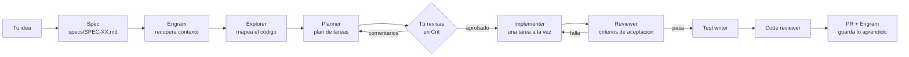

# Zero Code, Full Flutter

**Un kit de Spec-Driven Development (SDD) para Flutter con agentes de IA.**

Español · [English](README.md)

> Kit presentado en la charla *Zero Code, Full Flutter* por Renato Montufar ([@deus_magna](https://github.com/deus-magna)).
> Presentación: [`docs/zero-code-full-flutter.pdf`](docs/zero-code-full-flutter.pdf).

---

## Por qué existe

Pedirle a un agente de IA "hazme una app" te da código rápido, y también un montón de decisiones que
nadie tomó a propósito: requisitos ambiguos, una arquitectura que el modelo eligió por ti y
funcionalidades que nadie pidió. **Generar código es fácil. Saber qué construir, no.**

Spec-Driven Development invierte el orden:

1. **Especifica la intención.** Escribe qué significa "terminado" antes de que exista código.
2. **Revisa el plan.** Un agente convierte la spec en tareas pequeñas y verificables, y *tú* las
   apruebas.
3. **Valida el resultado.** Otros agentes comparan el resultado con la spec, escriben pruebas y
   revisan el código como lo haría un tech lead.

Las decisiones de ingeniería siguen siendo tuyas. Los agentes escriben.

## Qué trae el kit

```
zero-code-full-flutter/
├── AGENTS.md                 ← las reglas que siguen todos los agentes (arquitectura + flujo SDD)
├── CLAUDE.md                 ← solo importa AGENTS.md (Claude Code lee este archivo)
├── .claude/agents/           ← los 6 agentes para Claude Code
├── .opencode/agents/         ← los mismos agentes para opencode (opcional)
├── specs/
│   ├── _TEMPLATE.md          ← la plantilla de spec
│   └── plans/                ← los planes que genera el Planner
├── .github/                  ← plantilla de PR y de issue de seguimiento
├── docs/                     ← la presentación de la charla (PDF)
└── lib/main.dart             ← el contador clásico de Flutter, sin tocar (tu campo de práctica)
```

| Agente | Qué hace |
|---|---|
| `explorer` | Lee y mapea el código existente antes de planear (solo lectura). |
| `planner` | Convierte la spec en un plan de tareas ordenado. Nunca escribe código. |
| `implementer` | Escribe el código de **una** tarea del plan a la vez. |
| `reviewer` | Revisa la implementación contra los criterios de aceptación de la spec. |
| `test-writer` | Escribe pruebas unitarias de las capas domain, data y Bloc, solo donde hay lógica real. |
| `code-reviewer` | Revisión estilo tech lead del diff o del PR: bugs, riesgos, mantenibilidad. |

En Claude Code, **tu sesión principal es el orquestador**: habla contigo, escribe la spec y llama a
cada agente en el momento correcto, siguiendo `AGENTS.md`.

---

## Requisitos

| Herramienta | Para qué | Enlace |
|---|---|---|
| Flutter SDK | La app | <https://docs.flutter.dev/get-started/install> |
| Git | Control de versiones, una rama por spec | <https://git-scm.com/downloads> |
| Claude Code (u opencode) | Ejecuta los agentes | <https://docs.claude.com/en/docs/claude-code> · <https://opencode.ai> |
| Engram | Memoria persistente entre specs | <https://github.com/Gentleman-Programming/engram> |
| Crit | Revisar el plan en tu navegador con comentarios en línea | <https://github.com/tomasz-tomczyk/crit> |
| GitHub CLI (opcional) | PRs, issues y publicar el code review como comentarios del PR | <https://cli.github.com> |

Los comandos de instalación usan [Homebrew](https://brew.sh) (macOS/Linux). Para Windows u otros
métodos, sigue el enlace de cada herramienta.

---

## Instalación, paso a paso

### 1. Crea tu repo a partir de esta plantilla

En GitHub, dale clic a **Use this template → Create a new repository** y clónalo. O con GitHub CLI:

```bash
gh repo create mi-app --template deus-magna/zero-code-full-flutter --private --clone
cd mi-app
flutter pub get
flutter run        # deberías ver la app del contador
```

### 2. Instala Engram (memoria de los agentes)

```bash
brew install gentleman-programming/tap/engram
engram setup claude-code      # o: engram setup opencode
```

Después reinicia Claude Code. Otras plataformas y agentes:
[instalación de Engram](https://github.com/Gentleman-Programming/engram#install).

### 3. Instala Crit (revisión del plan)

```bash
brew install crit                                   # o: go install github.com/tomasz-tomczyk/crit/cmd/crit@latest
claude plugin marketplace add tomasz-tomczyk/crit   # plugin de Claude Code
claude plugin install crit@crit
```

¿Usas opencode? Ejecuta `crit install opencode`. Detalles: [Crit](https://github.com/tomasz-tomczyk/crit).

### 4. Verifica que todo esté conectado

Abre Claude Code en la carpeta del proyecto (`claude`) y:

- Ejecuta `/agents` → deberías ver `explorer`, `planner`, `implementer`, `reviewer`,
  `test-writer` y `code-reviewer`.
- Ejecuta `/mcp` → `engram` debe aparecer conectado.
- En una terminal, `crit --version` debe mostrar una versión.

### 5. Cuéntale a los agentes sobre tu proyecto

Abre `AGENTS.md` y llena la sección **Project specifics** (backend, navegación, reglas de
seguridad…). Para esta app del contador puedes dejarla así hasta que agregues un backend.

---

## El flujo



| Paso | Quién | Qué pasa | Resultado |
|---|---|---|---|
| 0. Spec | Tú + orquestador | Describes la idea con tus palabras. El orquestador pregunta lo ambiguo *antes* de escribir. | `specs/SPEC-XX.md` |
| 1. Contexto | Orquestador | Busca en Engram decisiones de specs anteriores. | — |
| 2. Explorar | `explorer` | Mapea el código involucrado y lo que se puede reutilizar. | Reporte |
| 3. Planear | `planner` | Divide la spec en tareas pequeñas: archivo, capa, dependencias, riesgo y cómo se verifica. | `specs/plans/SPEC-XX-plan.md` |
| 4. Revisar | **Tú**, en Crit | Comentas el plan línea por línea, como un PR. **No se escribe código hasta que apruebes.** | Plan aprobado |
| 5. Implementar | `implementer` | Una invocación por tarea; `flutter analyze` debe pasar antes de la siguiente. | Código |
| 6. Revisar | `reviewer` | Revisa cada criterio de aceptación con evidencia. | ✅ o tareas fallidas |
| 7. Pruebas | `test-writer` | Pruebas unitarias donde hay lógica real. | Pruebas |
| 8. Code review | `code-reviewer` | Revisión de tech lead del diff; deja comentarios en tu PR. | Hallazgos |
| 9. Memoria | Orquestador | Guarda decisiones y lecciones en Engram para la siguiente spec. | — |

Los cambios chicos (un typo, un bug de una línea) pueden saltarse el flujo; el orquestador te lo
dice.

---

## Tu primera feature, en 10 pasos

El contador de `lib/main.dart` usa `setState` y vive en un solo archivo. Tu primer ejercicio es
**migrarlo a la arquitectura del kit** (Clean Architecture + BLoC + GetIt) usando el flujo completo.

1. **Abre Claude Code** en la carpeta del proyecto: `claude`. Quédate en `main`; el orquestador crea
   la rama de la spec.
2. **Describe la idea con tus palabras.** Por ejemplo:
   > *Empecemos la SPEC-01. Quiero migrar el contador a nuestra arquitectura: una feature `counter`
   > con entidad, repositorio, casos de uso para incrementar y reiniciar, un Bloc y la vista. Guarda
   > el valor localmente para que sobreviva al reiniciar la app. Sigue el flujo SDD de AGENTS.md.*
3. **Responde las preguntas.** El orquestador pregunta lo que no esté claro (¿un botón de reiniciar?
   ¿qué almacenamiento local?). Tus respuestas quedan en la spec como directivas.
4. **Lee la spec** que escribe en `specs/SPEC-01.md`. Revisa los criterios de aceptación y el "Out
   of scope". Pide cambios hasta que diga exactamente lo que quieres y apruébala.
5. **Déjalo explorar y planear.** Crea la rama `feature/SPEC-01-...`, corre el Explorer y el
   Planner, y escribe `specs/plans/SPEC-01-plan.md`.
6. **Revisa el plan en Crit.** Se abre una pestaña del navegador. Comenta cualquier línea con la que
   no estés de acuerdo y dale clic a **Finish Review**. El plan se actualiza y vuelves a revisar
   hasta que te convenza.
7. **Míralo implementar**, tarea por tarea. Cada tarea debe pasar `flutter analyze` antes de la
   siguiente.
8. **Lee el reporte del Reviewer.** Cada criterio de aceptación aparece como aprobado o fallido, con
   evidencia. Las tareas fallidas vuelven al Implementer.
9. **Compruébalo tú mismo:** corre `flutter test` y `flutter run`. Toca el botón, reinicia la app y
   confirma que el valor sigue ahí.
10. **Abre el PR.** Pídele al orquestador que lo cree; el `code-reviewer` publica sus hallazgos como
    comentarios del PR. Tú decides qué corregir.

Al terminar, compara `lib/` antes y después, y vuelve a leer la spec y el plan. Ese rastro es el
punto.

---

## Usar el kit en un proyecto existente

Copia esto a tu repo:

```
AGENTS.md   CLAUDE.md   .claude/agents/   .opencode/agents/   specs/   .github/
```

Después:

1. Llena **Project specifics** en `AGENTS.md` (backend, reglas de seguridad, navegación…).
2. Si tu arquitectura es otra, adapta las secciones de arquitectura; la parte de SDD no depende de
   ella.
3. Elige el modelo de cada agente en su frontmatter (`.claude/agents/*.md`) según tu presupuesto.

---

## Preguntas frecuentes

**¿Necesito Claude Code y opencode?** No. Claude Code es el camino principal; las copias de
`.opencode/` están por si prefieres opencode: antes de usarlas, cambia `model: provider/model-id` en
cada `.opencode/agents/*.md` por tu proveedor y modelo. Si editas un agente, actualiza las dos copias.

**¿Puedo saltarme Engram o Crit?** El flujo está pensado alrededor de ellos: Crit es el punto de
aprobación humana y Engram guarda el contexto entre specs. Sin Crit puedes revisar el archivo del
plan a mano; sin Engram cada spec empieza sin memoria de las anteriores.

**¿Es lento o caro?** Una spec completa corre varios agentes, así que cuesta más que un solo prompt.
A cambio tienes menos vueltas en falso y un rastro revisable. Usa modelos más baratos para los
agentes de solo lectura (el Explorer usa `haiku` por defecto) y sáltate el flujo en cambios
triviales.

**¿Qué significa "Zero Code"?** Que tú no escribes el código, no que no haya ingeniería.
**Zero Code doesn't mean zero engineering.**

---

## Créditos

- Charla y kit: Renato Montufar ([@deus_magna](https://github.com/deus-magna)). Presentación:
  [`docs/zero-code-full-flutter.pdf`](docs/zero-code-full-flutter.pdf).
- [Crit](https://github.com/tomasz-tomczyk/crit), de Tomasz Tomczyk, y
  [Engram](https://github.com/Gentleman-Programming/engram), de Gentleman Programming, son proyectos
  independientes con sus propias licencias MIT; este kit solo documenta cómo usarlos.

## Licencia

[MIT](LICENSE)
