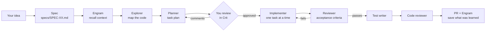

# Zero Code, Full Flutter

**A Spec-Driven Development (SDD) starter kit for Flutter with AI coding agents.**

[Español](README.es.md) · English

> Kit presented in the talk *Zero Code, Full Flutter* by Renato Montufar ([@deus_magna](https://github.com/deus-magna)).
> Slides: [`docs/zero-code-full-flutter.pdf`](docs/zero-code-full-flutter.pdf).

---

## Why this exists

Asking an AI agent "build me an app" gives you code fast — and a lot of decisions nobody made on
purpose: ambiguous requirements, an architecture the model picked for you, and features nobody
asked for. **Generating code is easy. Knowing what to build is not.**

Spec-Driven Development flips the order:

1. **Specify the intent.** Write down what "done" means before any code exists.
2. **Review the plan.** An agent turns the spec into small, verifiable tasks, and *you* approve them.
3. **Validate the outcome.** Other agents check the result against the spec, write tests and review
   the code like a tech lead.

You still own every engineering decision. The agents do the typing.

## What's in the kit

```
zero-code-full-flutter/
├── AGENTS.md                 ← the rules every agent follows (architecture + SDD flow)
├── CLAUDE.md                 ← just imports AGENTS.md (Claude Code reads this file)
├── .claude/agents/           ← the 6 agents for Claude Code
├── .opencode/agents/         ← the same agents for opencode (optional)
├── specs/
│   ├── _TEMPLATE.md          ← the spec template
│   └── plans/                ← plans generated by the Planner
├── .github/                  ← PR template and follow-up issue template
├── docs/                     ← the talk slides (PDF)
└── lib/main.dart             ← the classic Flutter counter, untouched (your playground)
```

| Agent | What it does |
|---|---|
| `explorer` | Reads and maps the existing code before planning (read-only). |
| `planner` | Turns the spec into an ordered task plan. Never writes code. |
| `implementer` | Writes the code for **one** task of the plan at a time. |
| `reviewer` | Checks the implementation against the spec's acceptance criteria. |
| `test-writer` | Writes unit tests for domain, data and Bloc layers — only real logic. |
| `code-reviewer` | Tech-lead style review of the diff or PR: bugs, risks, maintainability. |

In Claude Code, **your main session is the orchestrator**: it talks to you, writes the spec and
calls each agent at the right moment, following `AGENTS.md`.

---

## Requirements

| Tool | Why | Link |
|---|---|---|
| Flutter SDK | The app | <https://docs.flutter.dev/get-started/install> |
| Git | Version control, one branch per spec | <https://git-scm.com/downloads> |
| Claude Code (or opencode) | Runs the agents | <https://docs.claude.com/en/docs/claude-code> · <https://opencode.ai> |
| Engram | Persistent memory between specs | <https://github.com/Gentleman-Programming/engram> |
| Crit | Review the plan in your browser with inline comments | <https://github.com/tomasz-tomczyk/crit> |
| GitHub CLI (optional) | PRs, issues and posting the code review as PR comments | <https://cli.github.com> |

The install commands below use [Homebrew](https://brew.sh) (macOS/Linux). For Windows or other
methods, follow each tool's link.

---

## Setup, step by step

### 1. Create your repo from this template

On GitHub, click **Use this template → Create a new repository**, then clone it. Or with the
GitHub CLI:

```bash
gh repo create my-app --template deus-magna/zero-code-full-flutter --private --clone
cd my-app
flutter pub get
flutter run        # you should see the counter app
```

### 2. Install Engram (agent memory)

```bash
brew install gentleman-programming/tap/engram
engram setup claude-code      # or: engram setup opencode
```

Restart Claude Code afterwards. Other platforms and agents:
[Engram installation](https://github.com/Gentleman-Programming/engram#install).

### 3. Install Crit (plan review)

```bash
brew install crit                                   # or: go install github.com/tomasz-tomczyk/crit/cmd/crit@latest
claude plugin marketplace add tomasz-tomczyk/crit   # Claude Code plugin
claude plugin install crit@crit
```

Using opencode instead? Run `crit install opencode`. Details:
[Crit](https://github.com/tomasz-tomczyk/crit).

### 4. Check that everything is wired

Open Claude Code in the project folder (`claude`) and:

- Run `/agents` → you should see `explorer`, `planner`, `implementer`, `reviewer`,
  `test-writer` and `code-reviewer`.
- Run `/mcp` → `engram` should be listed as connected.
- In a terminal, `crit --version` should print a version.

### 5. Tell the agents about your project

Open `AGENTS.md` and fill in the **Project specifics** section (backend, navigation, security
rules…). For this counter app you can leave it as is until you add a backend.

---

## The flow



| Step | Who | What happens | Output |
|---|---|---|---|
| 0. Spec | You + orchestrator | You describe the idea in plain words. The orchestrator asks about anything ambiguous *before* writing. | `specs/SPEC-XX.md` |
| 1. Context | Orchestrator | Searches Engram for decisions from earlier specs. | — |
| 2. Explore | `explorer` | Maps the code involved and what can be reused. | Report |
| 3. Plan | `planner` | Breaks the spec into small tasks: file, layer, dependencies, risk, how it's verified. | `specs/plans/SPEC-XX-plan.md` |
| 4. Review | **You**, in Crit | You comment the plan line by line, like a PR. **No code is written until you approve.** | Approved plan |
| 5. Implement | `implementer` | One invocation per task; `flutter analyze` must pass before the next one. | Code |
| 6. Review | `reviewer` | Checks every acceptance criterion with evidence. | ✅ or failed tasks |
| 7. Tests | `test-writer` | Unit tests where there is real logic. | Tests |
| 8. Code review | `code-reviewer` | Tech-lead review of the diff; posts comments on your PR. | Findings |
| 9. Memory | Orchestrator | Saves decisions and lessons to Engram for the next spec. | — |

Small fixes (a typo, a one-line bug) can skip the flow — the orchestrator will say so.

---

## Your first feature, in 10 steps

The counter in `lib/main.dart` uses `setState` and lives in a single file. Your first exercise is to
**migrate it to the kit's architecture** (Clean Architecture + BLoC + GetIt) using the full flow.

1. **Open Claude Code** in the project folder: `claude`. Stay on `main`; the orchestrator creates
   the branch for the spec.
2. **Describe the idea in plain words.** For example:
   > *Let's start SPEC-01. I want to migrate the counter to our architecture: a `counter` feature
   > with entity, repository, use cases for increment and reset, a Bloc and the view. Save the value
   > locally so it survives restarting the app. Follow the SDD flow in AGENTS.md.*
3. **Answer the questions.** The orchestrator asks about anything unclear (A reset button? Which
   local storage?). Your answers go into the spec as directives.
4. **Read the spec** it writes in `specs/SPEC-01.md`. Check the acceptance criteria and "Out of
   scope". Ask for changes until it says exactly what you want, then approve it.
5. **Let it explore and plan.** It creates the branch `feature/SPEC-01-...`, runs the Explorer and
   the Planner, and writes `specs/plans/SPEC-01-plan.md`.
6. **Review the plan in Crit.** A browser tab opens. Comment any line you disagree with, then
   click **Finish Review**. The plan is updated and you review again until you're happy.
7. **Watch it implement**, task by task. Each task must pass `flutter analyze` before the next.
8. **Read the Reviewer's report.** Every acceptance criterion is marked as passed or failed, with
   evidence. Failed tasks go back to the Implementer.
9. **Check it yourself:** run `flutter test` and `flutter run`. Tap the button, restart the app and
   confirm the value is still there.
10. **Open the PR.** Ask the orchestrator to create it; the `code-reviewer` posts its findings as
    PR comments. You decide what to fix.

When you finish, compare `lib/` before and after — and read the spec and plan again. That paper
trail is the point.

---

## Using the kit in an existing project

Copy these into your repo:

```
AGENTS.md   CLAUDE.md   .claude/agents/   .opencode/agents/   specs/   .github/
```

Then:

1. Fill in **Project specifics** in `AGENTS.md` (backend, security rules, navigation…).
2. If your architecture differs, adapt the architecture sections — the SDD part does not depend on
   it.
3. Pick the models for each agent in their frontmatter (`.claude/agents/*.md`) to fit your budget.

---

## FAQ

**Do I need both Claude Code and opencode?** No. Claude Code is the main path; the `.opencode/`
copies are there if you prefer opencode: before using them, replace `model: provider/model-id` in
each `.opencode/agents/*.md` with your provider and model. If you edit an agent, update both copies.

**Can I skip Engram or Crit?** The flow is designed around them: Crit is the human approval gate
and Engram keeps context across specs. Without Crit you can review the plan file by hand; without
Engram each spec starts with no memory of the previous ones.

**Is it slow or expensive?** A full spec runs several agents, so it costs more than a single prompt.
In return you get fewer wrong turns and a reviewable trail. Use cheaper models for read-only agents
(the Explorer uses `haiku` by default) and skip the flow for trivial changes.

**What does "Zero Code" mean?** That you don't type the code — not that there is no engineering.
**Zero Code doesn't mean zero engineering.**

---

## Credits

- Talk and kit: Renato Montufar ([@deus_magna](https://github.com/deus-magna)). Slides:
  [`docs/zero-code-full-flutter.pdf`](docs/zero-code-full-flutter.pdf).
- [Crit](https://github.com/tomasz-tomczyk/crit) by Tomasz Tomczyk and
  [Engram](https://github.com/Gentleman-Programming/engram) by Gentleman Programming are independent
  projects with their own MIT licenses; this kit only documents how to use them.

## License

[MIT](LICENSE)
